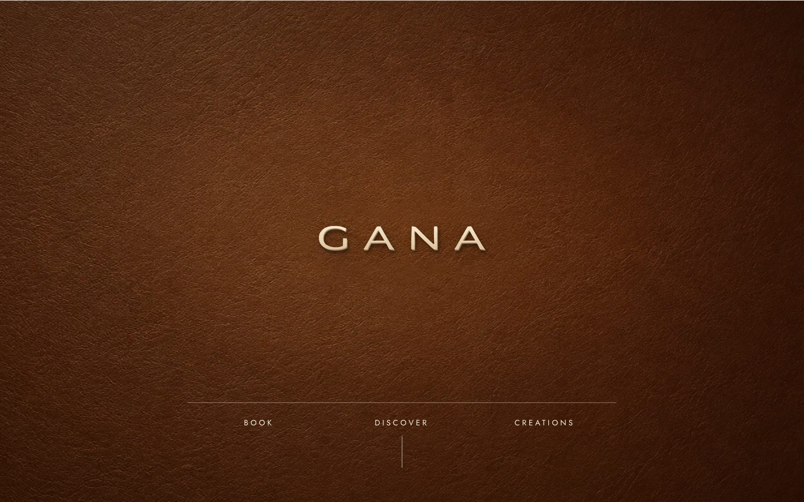
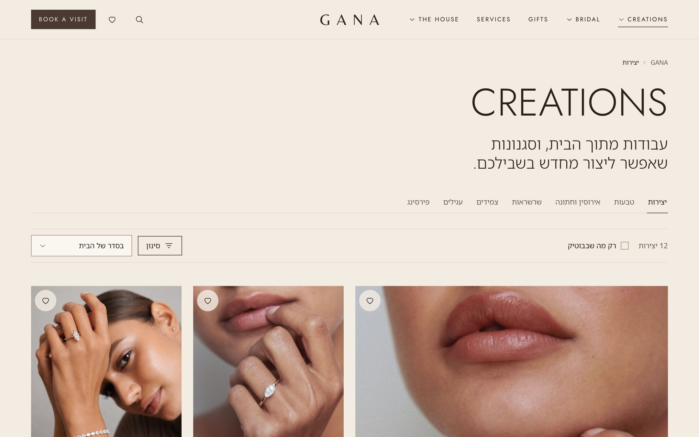
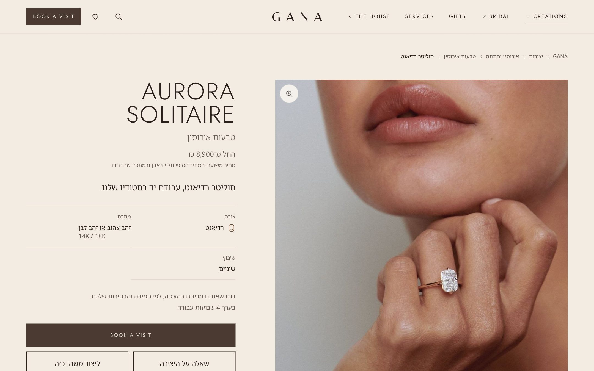
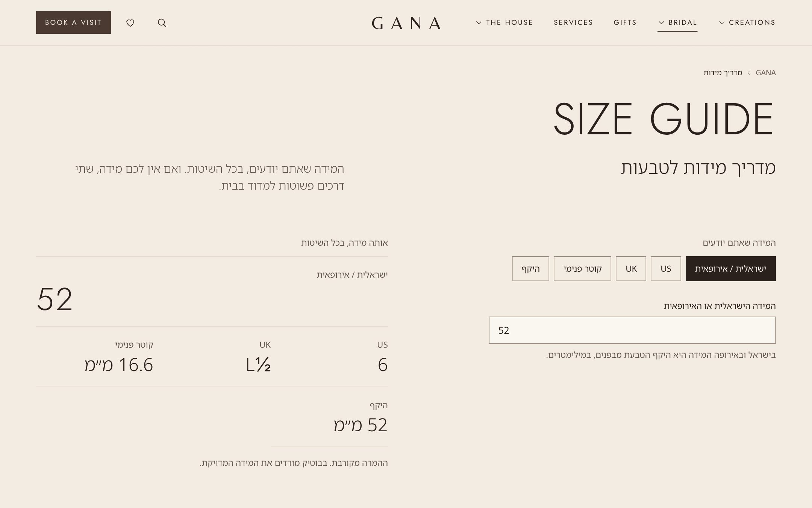
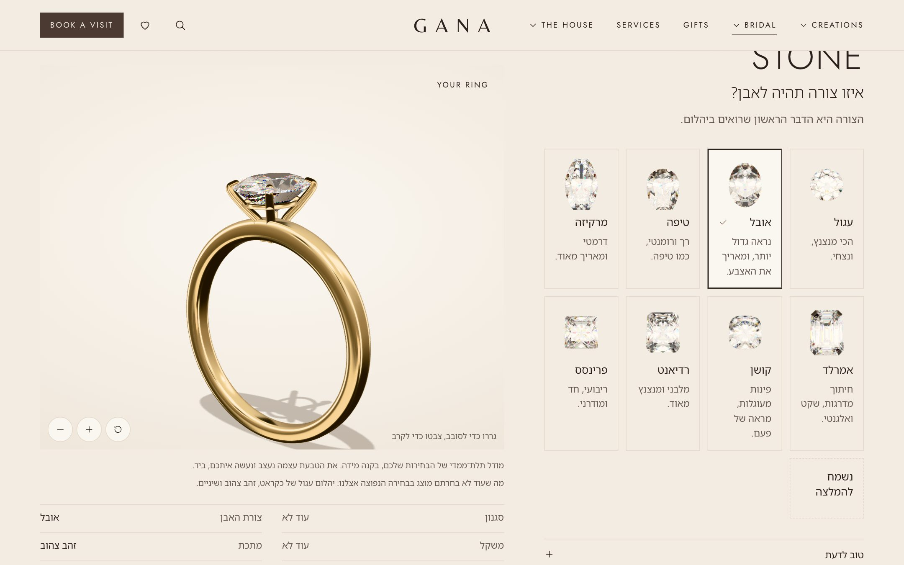
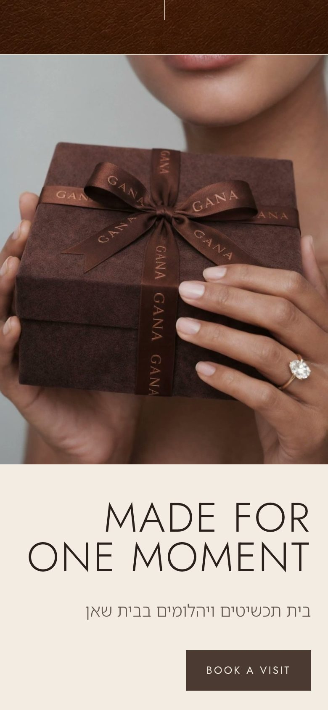
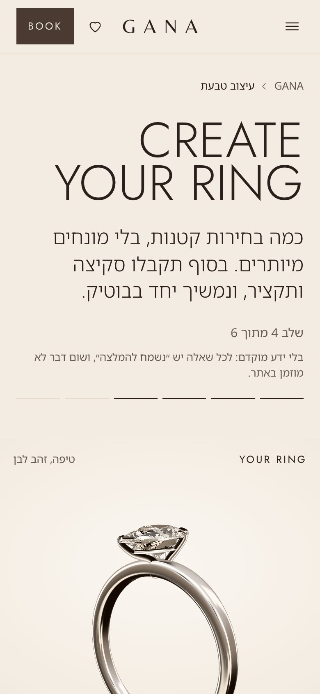
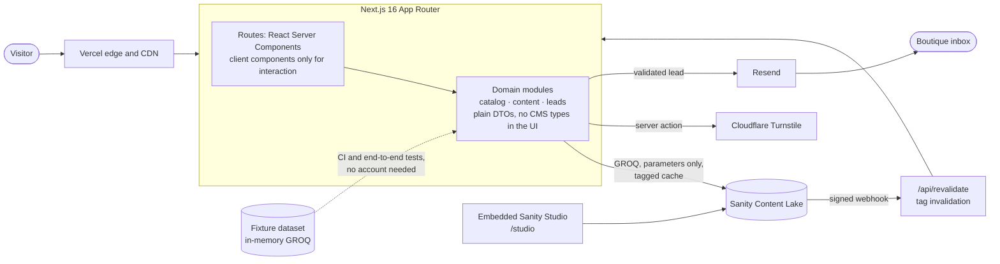

# GANA: a digital showroom for a jewellery house

A bilingual (Hebrew-first, right-to-left) website for **GANA**, a family jewellery and diamond house
in Beit She'an, Israel. It is a showroom, not a shop: visitors discover the creations, learn how to
choose a diamond, design a ring in 3D, and book a visit or ask a question. Every request reaches the
boutique as an email, and nothing about the visitor is stored.

> **The source code is private** (client project). This repository presents the product and its
> engineering. I am happy to walk through the code in an interview.

Status: pre-production, ready for launch (October 2026). Built solo, from architecture to delivery.

## What it does

- **One bilingual experience.** Hebrew for what must be understood, English for the brand's display
  words, a single URL per page (no `/he` and `/en` twins), full right-to-left layout with logical CSS
  only.
- **The house's content in its own hands.** An embedded Sanity Studio, in plain Hebrew, lets the
  owner manage creations, categories, collections, services, the home page's chapters, opening hours
  and every photograph, without a developer.
- **A ring configurator in real 3D.** Procedural ring geometry in millimetres and diamonds cut facet
  by facet (a 57-facet brilliant at ideal proportions), with light traced inside the stone (total
  internal reflection, dispersion) and physically based gold and platinum, in Three.js.
- **Conversion by contact.** Appointment requests (with the designed ring, saved favourites or a
  creation attached), questions about a piece, bespoke briefs, WhatsApp handoff. No cart, no payment.
- **Discovery.** A filterable gallery (metal, stone, shape, style, occasion, availability),
  collections, a gift guide, a diamond guide, an interactive ring size converter, search.

| | |
|---|---|
|  |  |
|  |  |

| Phone | | |
|---|---|---|
|  |  |  |

## Architecture

**Key decisions** (22 architecture decision records in the private repository):

- **Layered boundaries.** Routes and components import only the domain modules; importing the CMS
  from the UI is a lint error. Mappers turn raw CMS documents into typed DTOs, with locale fallback
  and dangling references dropped.
- **Caching.** Every fetch is tagged with the document types it reads; a signed Sanity webhook
  invalidates exactly the pages concerned.
- **Configuration that cannot fail silently.** Environment variables are validated with Zod at build
  time; a production build refuses demo content, a console mailer, Cloudflare's test keys or a
  template secret.
- **A launch switch.** Until it is turned on, every page is `noindex`, robots.txt is closed and an
  `X-Robots-Tag` header backs both, so the pre-production runs on the real infrastructure without
  being indexed.
- **Privacy by design.** Requests are never persisted (each one is an email with the visitor as
  reply-to), no cookies, analytics without personal data.
- **Security.** Strict Content Security Policy for the site and the Studio, HSTS, input validated on
  the server, CMS content never rendered as raw HTML, rate limiting and Turnstile on every form.
- **Fixtures mode.** A committed dataset is queried with the real GROQ through `groq-js`, so the whole
  test suite and the CI run with no external account and no secret.
- **3D, honestly.** Real geometry only; a choice the model cannot show yet is named, never drawn as
  something else. Without a graphics card the configurator falls back to words.

## Stack

Next.js 16 (App Router, React 19, Server Components, server actions) · TypeScript (strict) ·
Tailwind CSS v4 · next-intl · Sanity (Studio and Content Lake) · Three.js and three-mesh-bvh ·
Zod · Resend · Cloudflare Turnstile · Vercel (hosting, Web Analytics, Speed Insights) · Vitest ·
Playwright with axe-core · GitHub Actions · pnpm.

## Quality gates

Every push runs six gates in GitHub Actions, and none of them needs a secret:

| # | Gate | What it guarantees |
|---|---|---|
| 1 | **RTL check** | No physical direction classes (`ml-`, `left-`, `text-left`...): the layout mirrors correctly |
| 2 | **Typecheck** | Strict TypeScript, plus the Sanity schema validated and the generated query types in sync |
| 3 | **Lint** | ESLint, including the architectural boundaries (no CMS import in the UI) and React rules |
| 4 | **Unit and integration tests** | 264 Vitest tests: domain logic, mappers, GROQ queries run against the fixture dataset, migrations, environment rules |
| 5 | **Production build** | The build itself validates the environment and pre-renders the pages |
| 6 | **End-to-end tests** | 155 Playwright tests on desktop and phone: the journeys (gallery, creation, configurator, appointment, favourites, search), page transitions, and axe accessibility checks (WCAG 2.1 AA) on the main pages |

## Accessibility and performance

WCAG 2.1 AA checked by axe on the main pages in CI; keyboard paths, visible focus, reduced-motion
support throughout; responsive images from Sanity's CDN with blur placeholders; the 3D engine loads
only where a 3D piece is shown and draws only while something moves.

## Contact

[@ZakaryShemTov](https://github.com/ZakaryShemTov). The full code is available to review in an interview, on request.

---

Photographs and brand © GANA, all rights reserved. The screenshots show the site with its demonstration
content.
